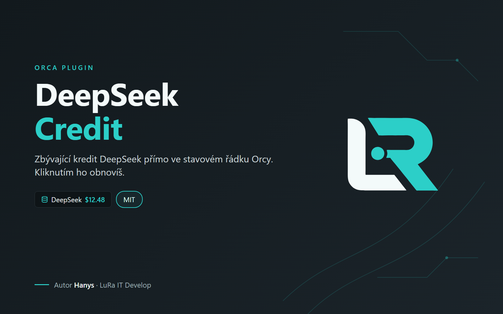

# DeepSeek Credit



Malý plugin pro [Orcu](https://github.com/stablyai/orca), který ukazuje **zbývající kredit na platformě DeepSeek**
přímo ve stavovém řádku, například `DeepSeek $12.48`. Kliknutím na položku se kredit hned obnoví.

*English version below: [English](#english).*

## Co plugin ukazuje

- **Stavový řádek:** aktuální zůstatek účtu DeepSeek. Pokud účet vede zůstatek v USD, ukáže se jen USD. Jinak se
  ukážou všechny měny (`¥` pro CNY, ostatní s kódem měny).
- **Tooltip:** celý zůstatek a nápověda, že kliknutím kredit obnovíš.
- **Varování:** bez klíče, s neplatným klíčem nebo při chybě sítě se položka přepne na varovnou ikonu a barvu
  a tooltip řekne, co se stalo (`Neplatný API klíč`, `HTTP 500` a podobně).

Je to zůstatek celého účtu DeepSeek, nezávisle na tom, který agent nebo aplikace kredit utratili.

## Nastavení

V nastavení pluginu v Orce:

| Klíč | Popis | Výchozí |
| --- | --- | --- |
| `apiKey` | API klíč z [platform.deepseek.com/api_keys](https://platform.deepseek.com/api_keys) | prázdný |
| `refreshMinutes` | Jak často se kredit znovu načítá (1 až 120 minut) | 5 |
| `language` | Jazyk textů ve stavovém řádku: `auto`, `cs` nebo `en` | `auto` |

Po změně nastavení se kredit načte znovu a interval obnovy se přenastaví.

### Jazyk

Texty ve stavovém řádku a v tooltipu jsou česky nebo anglicky. Orca pluginům na pozadí neposílá jazyk svého rozhraní,
proto volba **Auto** řídí jazyk podle systému: čeština a slovenština dají češtinu, cokoli jiného angličtinu. Kdo má
český systém a Orcu v angličtině (nebo naopak), přepne si jazyk ručně.

Názvy nastavení a příkazu v manifestu Orca překládat neumí, proto jsou anglicky.

Kredit lze obnovit také příkazem **DeepSeek Credit: Refresh credit** z palety příkazů.

## Soukromí a síť

- Jediný odchozí požadavek je `GET https://api.deepseek.com/user/balance` s tvým klíčem. Požadavek má časový limit
  8 sekund.
- Klíč je uložený v nastavení pluginu v Orce a nikam jinam se neposílá. Plugin neobsahuje žádnou analytiku ani
  telemetrii.

## Požadavky

- Orca `>=1.4.268`

## Vývoj

```bash
orca plugin dev watch .
orca plugin validate .
```

Náhledový obrázek `assets/cover.png` se generuje z `assets/cover.html`. Stačí stránku vyrenderovat v headless Chrome
s oknem 1600×1000:

```bash
chrome --headless=new --hide-scrollbars --window-size=1600,1000 --screenshot=assets/cover.png assets/cover.html
```

### Vydání nové verze

Stačí zvýšit `version` v `orca-plugin.json` a pushnout do `master`. Action
[`release.yml`](.github/workflows/release.yml) vytvoří tag `vX.Y.Z` a GitHub release, pokud pro tu verzi ještě
neexistují. Katalog Orcy si nový tag načte sám, obvykle do hodiny. Jednou vydaná verze se už nedá změnit.

## Licence

[MIT](LICENSE) © 2026 Lukas Hanak

---

## English

A small [Orca](https://github.com/stablyai/orca) plugin that shows your **remaining DeepSeek credit** in the status
bar, for example `DeepSeek $12.48`. Click the item to refresh it right away.

- **Status bar:** the current DeepSeek account balance. If the account has a USD balance, only USD is shown. Otherwise
  every currency is shown (`¥` for CNY, others with their currency code).
- **Warnings:** with no key, an invalid key or a network error, the item switches to a warning icon and colour and the
  tooltip says what went wrong.
- It is the balance of the whole DeepSeek account, whichever agent or app spent it.

### Settings

| Key | Description | Default |
| --- | --- | --- |
| `apiKey` | API key from [platform.deepseek.com/api_keys](https://platform.deepseek.com/api_keys) | empty |
| `refreshMinutes` | How often the credit is reloaded (1 to 120 minutes) | 5 |
| `language` | Status bar language: `auto`, `cs` or `en` | `auto` |

Orca does not tell background plugin workers its UI language, so **Auto** follows your system language: Czech or
Slovak gives Czech, anything else English. Pick a language by hand if your system and Orca differ.

You can also refresh with the **DeepSeek Credit: Refresh credit** command.

### Privacy and network

- The only outgoing request is `GET https://api.deepseek.com/user/balance` with your key, with an 8 second timeout.
- The key is stored in the plugin's Orca settings and is not sent anywhere else. No analytics, no telemetry.

Requires Orca `>=1.4.268`. Licensed under [MIT](LICENSE).
